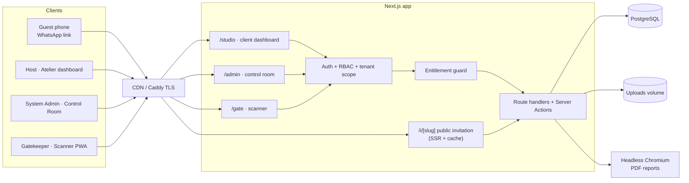

# System Architecture

## 1. Goals and constraints

- **Guest experience first.** The invitation must open beautifully on a mid-range phone over 4G, in WhatsApp's in-app browser, in Arabic or English.
- **Admin is god-mode, clients are scoped.** One codebase, strict tenant isolation, and per-client feature switches.
- **Simple to run.** A small team must be able to host it on one VPS with Docker, and scale it later without a rewrite.
- **Secure by default.** Wedding guest lists hold personal data (names and phone numbers). See [SECURITY.md](SECURITY.md).

## 2. Tech stack (as built in v0.1)

| Layer | Choice | Why |
|---|---|---|
| App framework | **Next.js 16 (App Router) + React 19 + TypeScript (strict)** | One codebase for admin, studio, invitations and API. Server Components and Server Actions keep logic on the server. |
| UI | Hand-built design system (`src/app/globals.css`) | Bespoke luxury look, accessible native controls, logical CSS properties for RTL |
| 3D | **Three.js** with four opening scenes | Envelope, doors, curtain and box, loaded lazily, with a 2D fallback |
| Database | **PostgreSQL 16 + Drizzle ORM** (SQL migrations in `drizzle/`) | Typed SQL, no native engine binaries. **PGlite** (embedded Postgres) for local development and tests. |
| Rate limits | Postgres table (fixed window) | Works across instances without Redis |
| Files | Local volume behind `/media/<id>` (S3 later) | Images re-encoded with **sharp**, audio checked by magic bytes |
| Reports | **ExcelJS** + **headless Chromium** (playwright-core) | Chromium shapes Arabic correctly in PDFs |
| Auth | Custom sessions + **argon2id** + **TOTP** (otpauth) | Admin-issued credentials only |
| Validation | **Zod 4** on every input and every stored JSON document | |
| Hosting | Docker Compose: `caddy` (HTTPS) → `app` → `db` | One VPS to start |

v0.1 decisions that differ from the first design: Drizzle replaced Prisma (Prisma 7's engines could not be installed in all environments), and Redis and pg-boss were left out. Reports render on request, and Postgres handles rate limits.

## 3. High-level diagram



## 4. Application modules (route groups)

```
app/
  (public)/i/[slug]/            → guest invitation (opening → sections → RSVP → pass)
  (public)/i/[slug]/[guestKey]/ → personalised guest link (pre-filled name, companion limit)
  (public)/pass/[passKey]/      → guest's QR pass (also "Add to calendar")
  (auth)/login, /setup-2fa, /change-password
  studio/                       → CLIENT (Atelier)
    page.tsx                    → overview: countdown, RSVP funnel, quick actions
    invitation/                 → theme picker + live editor
    guests/                     → guest list, import, send links, statuses
    rsvp/                       → RSVP form builder (per-field Off / Optional / Required)
    music/                      → library and trials (if entitled)
    gate/                       → manage gatekeepers, live check-in board
    reports/                    → PDF / Excel export (if entitled)
  admin/                        → SUPER_ADMIN / STAFF (Control Room)
    page.tsx                    → business overview
    clients/                    → create account, issue credentials, plan + overrides
    clients/[id]/manage         → "Manage as client" (audited impersonation)
    events/                     → every invitation across tenants
    themes/                     → theme catalogue and tier assignment
    plans/                      → tier × package presets (entitlement templates)
    music/                      → licensed music library
    audit/                      → audit log
    settings/                   → brand footer, tier names, languages
  gate/[eventId]/               → GATEKEEPER scanner (PWA, camera)
  api/
    rsvp/  pass/verify/  uploads/presign/  reports/  ics/[eventId]
```

## 5. Core domain concepts

| Concept | Meaning |
|---|---|
| **ClientAccount** | A paying customer (tenant). Has one **Plan** (tier × package) and optional **overrides**. |
| **Event** | One invitation (engagement, wedding, reception and so on). Belongs to one ClientAccount. Has a theme, content sections and an RSVP config. |
| **Theme** | A coded design (React component plus a JSON schema of what's customisable), tagged with a tier. |
| **Guest** | A person on the host's list, with a unique personal link and an allowed number of companions. |
| **Rsvp** | A guest's answer: attending or declined, plus the fields the host enabled. |
| **Pass** | A QR entry pass issued for an attending RSVP. Revocable. |
| **CheckIn** | A scan at the door by a gatekeeper. Prevents double entry and tracks how many people were admitted. |
| **Entitlements** | The effective feature set for a client = plan defaults ⊕ admin overrides. See [ENTITLEMENTS.md](ENTITLEMENTS.md). |

## 6. Key request flows

### 6.1 Admin creates a client
1. Admin → *Clients → New*: name, phone, package (Atelier / Concierge), tier, validity dates.
2. The server creates the `ClientAccount` and a `User(role=CLIENT)` with a username and a **one-time generated password** (shown once and copyable, never stored in plain text).
3. On first login the client must change the password.
4. Admin can adjust any feature switch later. The change takes effect on the next request (no cache past 60 s).

### 6.2 Host builds and publishes
1. Picks a theme from the tiers they are entitled to (higher tiers show as "Upgrade" previews).
2. The live editor is a split view: controls on one side, and an iframe preview on the other that receives config through `postMessage`.
3. Every save is a Zod-validated `EventConfig` stored in JSONB, with a version history (last 20).
4. Publish runs these checks: required fields set, entitlement check, guest-pass quota. The public page is then rebuilt and cached.

### 6.3 Guest opens the invitation
1. `/i/{slug}/{guestKey}` is SSR'd. The response holds a lightweight poster plus critical CSS, and the 3D scene lazy-loads.
2. Low-power devices, `prefers-reduced-motion` or WebGL failure fall back to a 2D CSS/video opening.
3. Music starts only after the first tap (browser autoplay rules). The opening tap ("Tap to open the seal") is that gesture.
4. The RSVP form is rendered from the host's RSVP config. Submitting it issues a Pass. See [GUEST-FLOW.md](GUEST-FLOW.md).

### 6.4 Reports
- The host or admin requests a report. A job is queued, the worker renders HTML to PDF (Playwright) or builds the XLSX (ExcelJS), and the file is stored privately and served by a short-lived signed URL.
- Contents: totals (invited, opened, attending, declined, pending, expected headcount), by side (bride or groom family), guest table, notes, and check-in timeline on the day.

## 7. Multi-tenancy

- Every tenant-owned row carries `accountId`.
- All data access goes through a **repository layer** that requires a `TenantContext` (`{ userId, role, accountId | null }`). Queries are automatically scoped, so there are no raw Prisma calls in route code (enforced by an ESLint rule).
- Admin access to tenant data goes through an explicit `actingAs(accountId)` context that **writes an AuditLog entry**.
- A Postgres **Row-Level Security** policy on `accountId` is planned as a second line of defence.

## 8. Performance budgets (guest page)

| Metric | Budget |
|---|---|
| First paint of the poster | < 1.2 s on 4G |
| LCP | < 2.5 s |
| JS before first tap | < 120 KB gzipped (3D chunk loads after) |
| 3D scene assets | < 2.5 MB, Draco/KTX2 compressed |
| Audio | 128 kbps AAC, streamed |

## 9. Environments

`local` (docker compose) → `staging` (staging.invites.nawat.om) → `production` (invites.nawat.om). Domains are suggestions.
CI: GitHub Actions runs lint, typecheck, unit tests, Playwright e2e and a Prisma migration check, then builds the Docker image and deploys.
